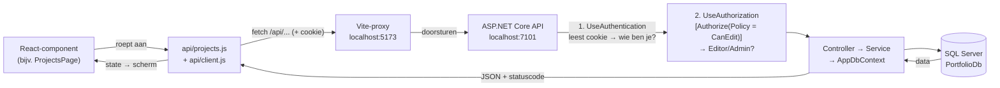

# wpfw_opdract3 – Portfolio (React + ASP.NET Core API)

Mijn portfolio-website: een **React-app (Vite)** die projecten en blogposts ophaalt uit mijn eigen **ASP.NET Core Web API**. De API slaat alles op in **SQL Server** via Entity Framework Core, gebruikt **ASP.NET Core Identity** voor accounts, cookies en rollen, en is getest met een **xUnit**-testproject.

**Student:** Ali Malfi

## Technieken
| Deel | Technieken |
|---|---|
| Frontend | React, Vite, React Router, JavaScript, CSS (mobile-first) |
| Backend | .NET 10 – ASP.NET Core Web API (controllers), Swagger UI |
| Database | Entity Framework Core 10 + SQL Server Express |
| Beveiliging | ASP.NET Core Identity (gebruikers, rollen, cookie-login) |
| Tests | xUnit + Microsoft.AspNetCore.Mvc.Testing (35 integratietests via HTTP) |

## Projectstructuur
| Map | Inhoud |
|---|---|
| `frontend/` | **React-app** (Vite) |
| `frontend/src/api` | API-functies: `client.js` (gedeelde fetch), `projects.js`, `blogposts.js`, `auth.js` |
| `frontend/src/auth` | `AuthContext.jsx`: ingelogde gebruiker, rol en `canEdit` |
| `frontend/src/pages` | Pagina's: home, projecten, blog, details, inloggen, registreren, 404 |
| `frontend/src/components` | Kaarten en formulieren voor projecten en blogposts |
| `wpfw_opdract3/` | **ASP.NET Core API** |
| `wpfw_opdract3/Controllers` | `ProjectsController`, `BlogpostsController`, `AuthController` |
| `wpfw_opdract3/Services` | Logica + omzetting entiteit ↔ DTO |
| `wpfw_opdract3/Data` | `AppDbContext` (IdentityDbContext) en `RoleSeeder` |
| `wpfw_opdract3/Models`, `DTOs`, `Auth` | Modellen, DTO's, rol- en policynamen |
| `wpfw_opdract3/Scripts` | `rollen-toekennen.sql` (lokaal Editor/Admin maken) |
| `wpfw_opdracht3.Tests/` | xUnit-testproject |

## Vereisten
- .NET 10 SDK
- Node.js 22 of hoger (met npm)
- SQL Server Express (`.\SQLEXPRESS`), inloggen met Windows-account
- SQL Server Management Studio (voor het rolscript)

---

## 1. SQL Server en database
Zorg dat **SQL Server Express** draait. De connectionstring staat in `wpfw_opdract3/appsettings.json`:

```json
"DefaultConnection": "Server=.\\SQLEXPRESS;Database=PortfolioDb;Trusted_Connection=True;TrustServerCertificate=True;"
```

De database en alle tabellen (ook de **Identity-tabellen** zoals `AspNetUsers` en `AspNetRoles`) worden **automatisch aangemaakt bij het opstarten** van de API: `RoleSeeder` voert `Database.MigrateAsync()` uit en maakt de rollen **Gast**, **Editor** en **Admin** aan.

Handmatig migreren kan ook:
```bash
dotnet ef database update --project wpfw_opdract3
```

## 2. API starten
Vanuit de hoofdmap van de repository:
```bash
dotnet run --project wpfw_opdract3 --launch-profile https
```
- De API draait op `https://localhost:7101`
- Swagger UI: `https://localhost:7101/`

> Gebruik het profiel **https**: de Vite-proxy stuurt verzoeken naar `https://localhost:7101`.

## 3. React starten
In een **tweede terminal**:
```bash
cd frontend
npm install
npm run dev
```
- De website draait op `http://localhost:5173`
- `npm install` is alleen de eerste keer nodig (en na nieuwe pakketten).

## 4. Testgebruikers en rollen
Er staan **geen wachtwoorden of sleutels** in de repository of in de frontendcode.

1. **Gast:** registreer via de website (`/registreren`) of via `POST /api/auth/register`. Iedere nieuwe gebruiker krijgt automatisch de rol **Gast**. Publieke registratie kent nooit Editor of Admin toe.
2. **Editor en Admin:** registreer eerst `editor@test.nl` en `admin@test.nl` (met een eigen wachtwoord).
3. Open `wpfw_opdract3/Scripts/rollen-toekennen.sql` in SQL Server Management Studio en voer het uit (**F5**). Het script vervangt de rol Gast door **Editor** of **Admin**.
4. **Log opnieuw in.** De rollen worden bij het inloggen in de cookie gezet, dus na een rolwijziging is een nieuwe login nodig.

Wachtwoordregels (Identity): minimaal 6 tekens, met hoofdletter, kleine letter, cijfer en speciaal teken.

---

## 5. Hoe frontend, API en database samenwerken



### De Vite-proxy
In `frontend/vite.config.js` staat een proxy: alles wat met `/api` begint, stuurt Vite door naar `https://localhost:7101`. Daardoor:
- praat React met **hetzelfde adres** (`localhost:5173`), dus er is **geen CORS-instelling** nodig;
- stuurt de browser de **Identity-cookie** gewoon mee;
- staat er nergens een API-adres of sleutel in de React-code.

### Een GET-verzoek (projecten bekijken)
1. React Router opent `ProjectsPage`.
2. `useEffect` roept `getProjects()` aan (`api/projects.js` → `api/client.js`).
3. `fetch('/api/Projects')` gaat via de proxy naar de API.
4. `ProjectsController` → `ProjectService` → `AppDbContext` → SQL Server.
5. De API stuurt JSON terug; React bewaart het in state (`setProjects`) en toont de kaarten.
6. Tijdens laden, bij een lege lijst, een fout of een onbekend id toont React een passende melding.

### Een schrijfactie (project toevoegen)
1. Editor/Admin vult `ProjectForm` in; React controleert de invoer eerst zelf.
2. `createProject()` doet `POST /api/Projects` met `credentials: 'include'`: de **cookie** gaat mee.
3. **Identity herkent de gebruiker**: `app.UseAuthentication()` leest de cookie.
4. **De API controleert de rol**: `app.UseAuthorization()` + `[Authorize(Policy = Policies.CanEdit)]` (Editor of Admin).
   - geen cookie → **401**, rol Gast → **403**, ongeldige invoer → **400** (DTO-validatie).
5. Gelukt → **201**; React toont een melding en haalt de lijst opnieuw op.

### Aanmelden in React
- **Inloggen:** `POST /api/auth/login` → de API zet de cookie (`HttpOnly`, niet leesbaar voor JavaScript).
- **Na verversen (F5):** `AuthContext` vraagt `GET /api/auth/me` → `{ email, rollen }` of **401** (niet ingelogd).
- **Beheerknoppen** zijn alleen zichtbaar als `canEdit` waar is (Editor/Admin). Dat is alleen voor de duidelijkheid: **de API controleert zelf bij elke schrijfactie**.
- React bewaart **geen wachtwoorden of tokens** in de code of in `localStorage`.

---

## 6. Cookies en CSRF vóór een deployment
Lokaal werkt alles via de proxy op **één origin**. Bij een echte deployment moet je hierop letten:

**Cookie-instellingen**
- **Secure:** cookie alleen via HTTPS versturen (`CookieSecurePolicy.Always`).
- **HttpOnly:** blijft aan, zodat JavaScript de cookie niet kan lezen (bescherming tegen XSS).
- **SameSite:**
  - Frontend en API op **hetzelfde domein** (aanrader): `SameSite=Lax` of `Strict` volstaat.
  - Frontend en API op **verschillende domeinen**: `SameSite=None` + `Secure` is nodig. Dan ook een **CORS-policy** met alleen het frontend-domein (`WithOrigins(...)`) en `AllowCredentials()`.
- **Verlooptijd:** stel `ExpireTimeSpan` / `SlidingExpiration` bewust in.

**CSRF (Cross-Site Request Forgery)**
- Omdat de browser de cookie **automatisch** meestuurt, kan een andere website proberen namens de gebruiker een verzoek te sturen.
- `SameSite=Lax/Strict` blokkeert de meeste van deze verzoeken. Is `SameSite=None` nodig, voeg dan **antiforgery-tokens** toe (ASP.NET Core `IAntiforgery`: de API geeft een token, React stuurt het mee in een header, de API controleert het bij POST/PUT/DELETE).
- De API accepteert alleen JSON en CORS staat alleen het eigen frontend-domein toe.

**Overig**
- Connectionstring en andere geheimen via **omgevingsvariabelen** of een secrets-manager, niet in de repository.
- Overal **HTTPS** (met HSTS).

---

## 7. Tests en build
**Backendtests** (vanuit de hoofdmap):
```bash
dotnet test
```
- 35 tests via `WebApplicationFactory` en echte HTTP-requests, waaronder 2 tests voor `GET /api/auth/me`.
- Aparte testdatabase **`PortfolioDb_Test`**, die bij elke testrun opnieuw wordt aangemaakt. `PortfolioDb` wordt niet aangeraakt.

**Frontend controleren en bouwen** (in `frontend/`):
```bash
npm run lint
npm run build
```
`npm run build` maakt een geoptimaliseerde versie in `frontend/dist/` (staat in `.gitignore`).

---

## Endpoints
| Methode | Route | Toegang |
|---|---|---|
| GET | `/api/projects` | iedereen |
| GET | `/api/projects/{id}` | iedereen |
| POST | `/api/projects` | Editor, Admin |
| PUT | `/api/projects/{id}` | Editor, Admin |
| DELETE | `/api/projects/{id}` | Editor, Admin |
| GET | `/api/blogposts` | iedereen |
| GET | `/api/blogposts/{id}` | iedereen |
| POST | `/api/blogposts` | Editor, Admin |
| PUT | `/api/blogposts/{id}` | Editor, Admin |
| DELETE | `/api/blogposts/{id}` | Editor, Admin |
| POST | `/api/auth/register` | iedereen (krijgt rol Gast) |
| POST | `/api/auth/login` | iedereen |
| POST | `/api/auth/logout` | iedereen |
| GET | `/api/auth/me` | ingelogd (anders 401) |

## React-routes
| Route | Pagina |
|---|---|
| `/` | Home |
| `/projecten`, `/projecten/:id` | Projectenlijst en detail |
| `/blog`, `/blog/:id` | Bloglijst en detail |
| `/inloggen`, `/registreren` | Aanmelden |
| `*` | 404 – pagina niet gevonden |