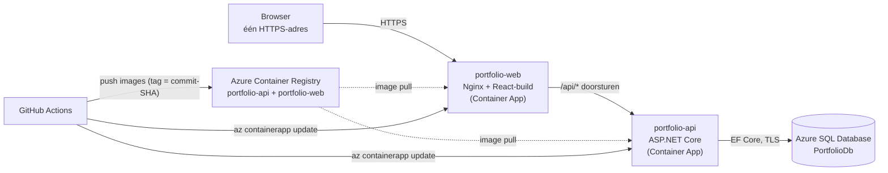

# Portfolio – Ali Malfi (WPFW opdracht 3 t/m 6)

Persoonlijke portfolio-website met projecten en blogposts. React-frontend, ASP.NET Core Web API (.NET 10) met Identity-cookies en SQL Server via EF Core. Lokaal draait alles met Docker Compose, online draait het in Azure Container Apps en GitHub Actions publiceert elke nieuwe versie.

- **Live website:** https://portfolio-web.jollycoast-aab9be34.swedencentral.azurecontainerapps.io
- **Repository:** https://github.com/AliMalfi/wpfw_opdract3

| Map / bestand | Inhoud |
| --- | --- |
| `wpfw_opdract3/` | ASP.NET Core Web API (controllers, services, Identity, EF Core, migraties) + `Dockerfile` |
| `wpfw_opdracht3.Tests/` | xUnit-tests met WebApplicationFactory (37 tests) |
| `frontend/` | React + Vite, `Dockerfile` en `nginx.conf.template` |
| `compose.yaml` | Lokale services `db`, `api`, `web` en het volume `portfolio-data` |
| `.env.example` | Voorbeeld van de lokale geheimen (kopieer naar `.env`) |
| `.github/workflows/ci-cd.yml` | GitHub Actions: verify → publish → deploy |

## Architectuur



Lokaal is het hetzelfde, maar dan met Docker Compose: `web` (Nginx op poort 8080) stuurt `/api` door naar `api:8080` en de API praat met de SQL Server-container `db`. De browser gebruikt dus altijd één adres, waardoor de Identity-cookie gewoon meegaat.

## 1. Lokaal starten met Docker Compose

Benodigd: Docker Desktop (Linux-containers).

1. Maak je eigen `.env` (staat in `.gitignore`, wordt nooit gecommit):

   ```powershell
   Copy-Item .env.example .env
   ```

   Vul `MSSQL_SA_PASSWORD` in met een zelfgekozen sterk wachtwoord (minimaal 8 tekens, hoofdletter, kleine letter, cijfer en teken, zonder `;`).

2. Bouwen en starten:

   ```powershell
   docker compose up -d --build
   docker compose ps
   ```

   Je ziet `db` (healthy), `api` en `web`. Open **http://localhost:8080**.

3. Data blijft bewaard in het benoemde volume `portfolio-data`. Controle:

   ```powershell
   docker compose up -d --force-recreate
   ```

   Gebruik **nooit** `docker compose down -v`: `-v` verwijdert ook het volume en dus je lokale data.

De SQL Server-container is vanaf je laptop bereikbaar op `127.0.0.1,14330` (bijvoorbeeld in SSMS, login `sa`).

## 2. Ontwikkelen zonder containers

```powershell
dotnet run --project wpfw_opdract3 --launch-profile https   # API op https://localhost:7101
cd frontend
npm install
npm run dev                                                 # React op http://localhost:5173
```

De Vite-proxy stuurt `/api` door naar `https://localhost:7101`. De API gebruikt dan de connection string uit `appsettings.Development.json` (SQL Server Express).

## 3. Configuratie

Geen enkel wachtwoord staat in de repository. Waarden komen uit omgevingsvariabelen.

| Instelling | Waar | Doel |
| --- | --- | --- |
| `MSSQL_SA_PASSWORD` | `.env` (lokaal) | Wachtwoord van de lokale SQL Server-container |
| `ConnectionStrings__DefaultConnection` | `compose.yaml` (lokaal), **secret** `db-conn` in de Container App (Azure) | Verbinding met de database |
| `ASPNETCORE_ENVIRONMENT` | `Development` lokaal, `Production` in Azure | In Production: geen Swagger, cookies alleen via HTTPS |
| `API_URL` | `web`-container | Waar Nginx `/api` naartoe stuurt (`http://api:8080` lokaal, het HTTPS-adres van `portfolio-api` in Azure) |
| `TEST_CONNECTION_STRING` | GitHub Actions | Tijdelijke testdatabase in CI (lokaal: `.\SQLEXPRESS`) |
| `AZURE_CLIENT_ID`, `AZURE_TENANT_ID`, `AZURE_SUBSCRIPTION_ID`, `ACR_NAME`, `RESOURCE_GROUP` | GitHub → Settings → Secrets and variables → Actions → **Variables** | Inloggen bij Azure via OIDC (geen wachtwoord) en namen van de resources |

## 4. Migraties

Bij het opstarten voert de API de EF Core-migraties automatisch uit (`RoleSeeder.SeedRolesAsync` → `Database.MigrateAsync()`) en maakt de rollen Gast, Editor en Admin aan. Dat geldt lokaal, in Docker en in Azure.

Handmatig uitvoeren kan ook, bijvoorbeeld op de Docker-database:

```powershell
$env:ConnectionStrings__DefaultConnection = "Server=127.0.0.1,14330;Database=PortfolioDb;User Id=sa;Password=JOUW_WACHTWOORD;TrustServerCertificate=True;"
dotnet ef database update --project wpfw_opdract3
```

Een nieuwe migratie maken: `dotnet ef migrations add NaamVanMigratie --project wpfw_opdract3`.

## 5. Testrollen

Er bestaan geen accounts met een standaardwachtwoord.

1. Registreer via de website (lokaal of live). Een nieuw account krijgt altijd de rol **Gast**.
2. Maak het account Editor of Admin met een vertrouwde beheerhandeling: verbind met SSMS met de database (lokaal `127.0.0.1,14330`, Azure `sql-portfolio-ali-25058932.database.windows.net` met database `PortfolioDb`) en voer `wpfw_opdract3/Scripts/rollen-toekennen.sql` uit met het juiste e-mailadres en de rol.
3. Log opnieuw in, zodat de nieuwe rol in de cookie komt.

| Rol | Mag |
| --- | --- |
| Niet ingelogd / Gast | Lijsten en details bekijken |
| Editor / Admin | Ook toevoegen, wijzigen en verwijderen (policy `CanEdit`) |

## 6. Tests en build

```powershell
dotnet test            # vanuit de hoofdmap: 37 tests
cd frontend
npm ci
npm run lint
npm run build
```

De tests starten de hele API met WebApplicationFactory en een aparte database `PortfolioDb_Test`. In GitHub Actions start de workflow daarvoor een tijdelijke SQL Server-container met een willekeurig wachtwoord.

## 7. Beveiliging

- **Cookies:** de Identity-cookie is `HttpOnly`, `SameSite=Strict` en in Production altijd `Secure` (alleen via HTTPS).
- **CSRF:** React haalt vóór elke POST/PUT/DELETE een token op via `GET /api/security/csrf` en stuurt het mee in de header `X-CSRF-TOKEN`. De `CsrfFilter` weigert schrijfacties zonder geldig token met 400. Login- en rolcontrole blijven daarnaast gewoon nodig.
- **Data Protection:** de sleutels die de cookie versleutelen staan in de database (tabel `DataProtectionKeys`). Daardoor blijven gebruikers ingelogd als een container vervangen wordt.
- **Forwarded headers:** Azure en Nginx stoppen HTTPS vóór Kestrel; de API neemt `X-Forwarded-Proto` over, zodat hij weet dat de bezoeker HTTPS gebruikte.

## 8. Azure

| Resource | Naam |
| --- | --- |
| Resource group (Sweden Central) | `rg-portfolio-ali` |
| Container Registry (Basic) | `acrportfolioali25058932` |
| Container Apps-omgeving | `cae-portfolio` |
| Container Apps | `portfolio-web` (website), `portfolio-api` (API) |
| Azure SQL | server `sql-portfolio-ali-25058932`, database `PortfolioDb` (gratis aanbod, serverless) |
| Identiteiten | `id-portfolio` (AcrPull, images ophalen), `id-github-portfolio` (AcrPush + Contributor, voor GitHub Actions via OIDC) |

Opmerkingen:

- Azure for Students maakt een Container Apps **Express**-omgeving. Die kent geen interne service discovery en geen system-assigned identity. Daarom haalt de API zijn image op met de user-assigned identity `id-portfolio` en heeft de API een eigen HTTPS-adres waar Nginx naartoe doorstuurt. De API blijft beschermd door login, rollen, CSRF-token en `SameSite=Strict`-cookies.
- De gratis database pauzeert na een tijd zonder gebruik. Het eerste verzoek daarna duurt ongeveer een minuut.

## 9. Opnieuw publiceren

Elke push naar `master` start `.github/workflows/ci-cd.yml`:

1. **verify** – `dotnet test` (met tijdelijke SQL Server) en `npm ci` + `npm run build`. Faalt dit, dan wordt er niets gepubliceerd.
2. **publish** – bouwt `portfolio-api` en `portfolio-web` en pusht ze naar ACR met de commit-SHA als tag.
3. **deploy** – `az containerapp update` zet beide apps op de nieuwe image.

Pull requests voeren alleen **verify** uit. Handmatig starten kan via **Actions → Portfolio CI en CD → Run workflow**. Het testproject wordt niet gedeployed.

Terug naar een vorige versie:

```powershell
az containerapp update --name portfolio-web --resource-group rg-portfolio-ali --image acrportfolioali25058932.azurecr.io/portfolio-web:<oude-commit-sha>
```

## 10. Endpoints

| Methode en route | Toegang | Succes |
| --- | --- | --- |
| GET `/api/Projects`, `/api/Blogposts` | Publiek | 200 |
| GET `/api/Projects/{id}`, `/api/Blogposts/{id}` | Publiek | 200, of 404 |
| POST `/api/Projects`, `/api/Blogposts` | Editor of Admin + CSRF-token | 201 |
| PUT `/api/Projects/{id}`, `/api/Blogposts/{id}` | Editor of Admin + CSRF-token | 204, of 404 |
| DELETE `/api/Projects/{id}`, `/api/Blogposts/{id}` | Editor of Admin + CSRF-token | 204, of 404 |
| POST `/api/Auth/register` | Publiek + CSRF-token | 200, nieuwe gebruiker is Gast |
| POST `/api/Auth/login` | Publiek + CSRF-token | 200 met cookie |
| POST `/api/Auth/logout` | Ingelogd + CSRF-token | 200 |
| GET `/api/Auth/me` | Ingelogd | 200 met e-mail en rollen, anders 401 |
| GET `/api/security/csrf` | Publiek | 200 met token |

Niet ingelogd bij een schrijfactie → 401, Gast → 403, ontbrekend CSRF-token → 400.